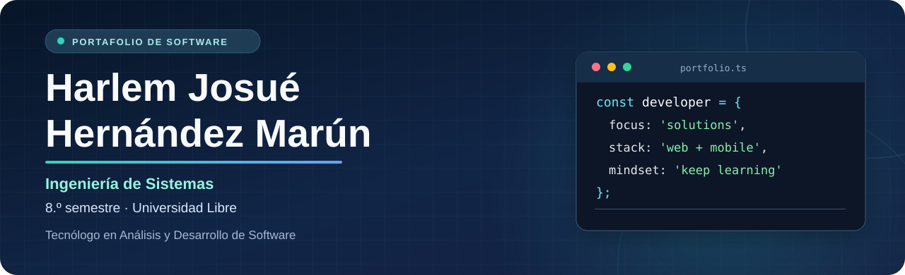
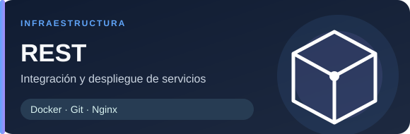
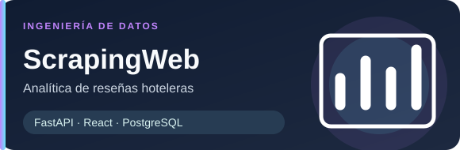
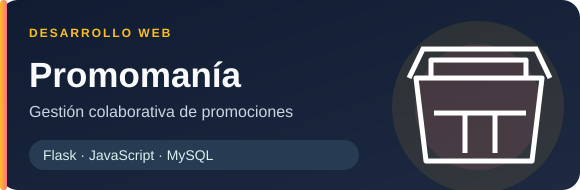
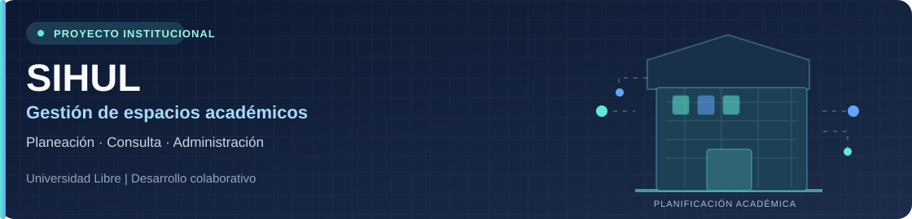
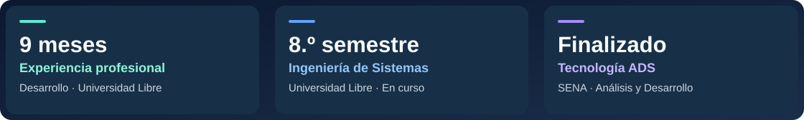

 

**Construyo soluciones digitales: de la idea al desarrollo, la integración y el despliegue.**

📍 Barranquilla, Colombia &nbsp;•&nbsp; 🇨🇴 Español &nbsp;•&nbsp; 🌱 Aprendizaje continuo

---

## 👋 Sobre mí

Soy **estudiante de Ingeniería de Sistemas (8.º semestre)** en la **Universidad Libre** y **Tecnólogo en Análisis y Desarrollo de Software del SENA (formación finalizada)**.

Cuento con **9 meses de experiencia** en desarrollo y mantenimiento de software para la Universidad Libre. Me interesa transformar necesidades reales en aplicaciones web y móviles, integrando APIs, bases de datos y soluciones de infraestructura. También participo en iniciativas académicas de investigación y desarrollo tecnológico.

<table>
<tr>
<td width="50%" valign="top">

### ⚡ Lo que hago
- 💻 Desarrollo de aplicaciones web y móviles.
- 🔗 Diseño e integración de APIs REST.
- 🗃️ Modelado y gestión de bases de datos.
- 🐳 Contenedores, despliegue e integración de servicios.

</td>
<td width="50%" valign="top">

### 🎯 En qué me enfoco
- 🏗️ Arquitectura y buenas prácticas de software.
- 🤖 Automatización de procesos e IA aplicada.
- 🧩 Resolución de problemas reales.
- 🤝 Colaboración e investigación tecnológica.

</td>
</tr>
</table>

## 🧰 Tecnologías y herramientas

**Lenguajes de programación**

**Aplicaciones web y móviles**

**Backend y bases de datos**

**Infraestructura y herramientas**

Integraciones trabajadas: Mercado Pago (sandbox) · Google OAuth · Resend · Twilio

## 🚀 Proyectos destacados

<table>
<tr>
<td width="50%" valign="top">

**🚗 FlexiDrive**

Aplicación de alquiler de vehículos con gestión de usuarios, vehículos, reservas y pagos en entorno de pruebas.

**Stack:** Flutter · Django REST · PostgreSQL · Docker

[**Explorar repositorio →**](https://github.com/devHarlemHM/FlexiDrive)

</td>
<td width="50%" valign="top">

**🧩 REST — Integración de servicios**

Orquestación de aplicación, panel y backend con submódulos Git, Docker Compose y Nginx. Desarrollo colaborativo.

**Stack:** Git · Docker · Nginx

[**Explorar repositorio →**](https://github.com/devHarlemHM/REST)

</td>
</tr>
<tr>
<td width="50%" valign="top">

**📊 ScrapingWeb**

Recolección, gestión y análisis de reseñas hoteleras mediante servicios API y panel web.

**Stack:** Python · FastAPI · React · PostgreSQL

[**Explorar repositorio →**](https://github.com/devHarlemHM/ScrapingWeb)

</td>
<td width="50%" valign="top">

**🛒 Promomanía**

Aplicación web para consulta y administración de promociones, productos y usuarios.

**Stack:** Flask · JavaScript · MySQL

[**Explorar repositorio →**](https://github.com/devHarlemHM/Promomania)

</td>
</tr>
</table>

## 🏛️ Proyecto institucional destacado

### SIHUL · Gestión de espacios académicos

Participación en el desarrollo de una solución institucional para **planear, consultar y administrar espacios académicos** de la Universidad Libre.

<table>
<tr>
<td width="33%" align="center"><strong>📅 Planeación</strong> Organización de espacios y horarios académicos.</td>
<td width="33%" align="center"><strong>🔎 Consulta</strong> Información sobre ocupación y disponibilidad.</td>
<td width="33%" align="center"><strong>🛠️ Gestión</strong> Soporte a la administración de los espacios.</td>
</tr>
</table>

Proyecto institucional y colaborativo · El código no está publicado en esta cuenta.

## 🎓 Experiencia y formación

<strong>Ver información académica y profesional</strong>

 

- **Experiencia:** 9 meses en desarrollo y mantenimiento de software para la Universidad Libre.
- **Ingeniería de Sistemas:** Universidad Libre, Barranquilla — **8.º semestre (en curso)**.
- **Tecnólogo en Análisis y Desarrollo de Software:** SENA — **finalizado**.
- **Formación complementaria:** análisis de datos y fundamentos de Python.

## 🔬 Investigación, innovación y comunidad

<table>
<tr>
<td width="33%" valign="top" align="center">
<h3>🔬 Semillero</h3>
Participación en actividades de investigación y desarrollo tecnológico.
</td>
<td width="33%" valign="top" align="center">
<h3>🏆 Hackatón</h3>
Participación en una hackatón universitaria de desarrollo de software.
</td>
<td width="33%" valign="top" align="center">
<h3>🎤 RedCOLSI</h3>
Ponencia académica con una propuesta de investigación.
</td>
</tr>
</table>

## 📊 Mi actividad en GitHub

<table>
<tr>
<td width="52%" valign="middle" align="center">

</td>
<td width="48%" valign="middle">

### Explora mi trabajo

El mejor reflejo de mi experiencia está en el **código, la documentación y los proyectos**.

- 📂 [Ver repositorios públicos](https://github.com/devHarlemHM?tab=repositories)
- 🌱 [Ver contribuciones y actividad](https://github.com/devHarlemHM)
- 🧩 [Explorar mis proyectos destacados](#-proyectos-destacados)

La distribución de lenguajes se calcula a partir del código público y no mide habilidades ni experiencia.

</td>
</tr>
</table>

---

### 🤝 ¿Construimos algo útil?

Me interesa colaborar en proyectos de desarrollo de software, integración de sistemas, automatización e innovación tecnológica.

Hecho con código, curiosidad y ganas de seguir aprendiendo. ✨

